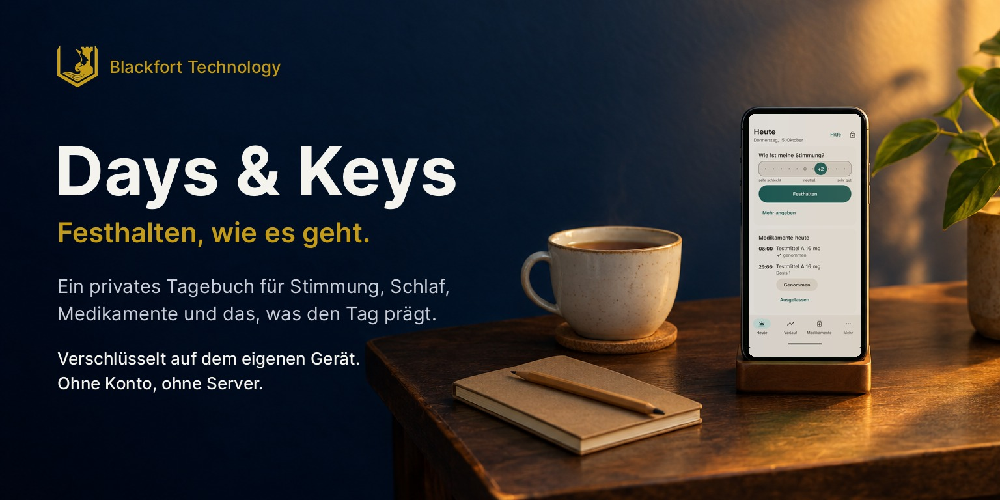
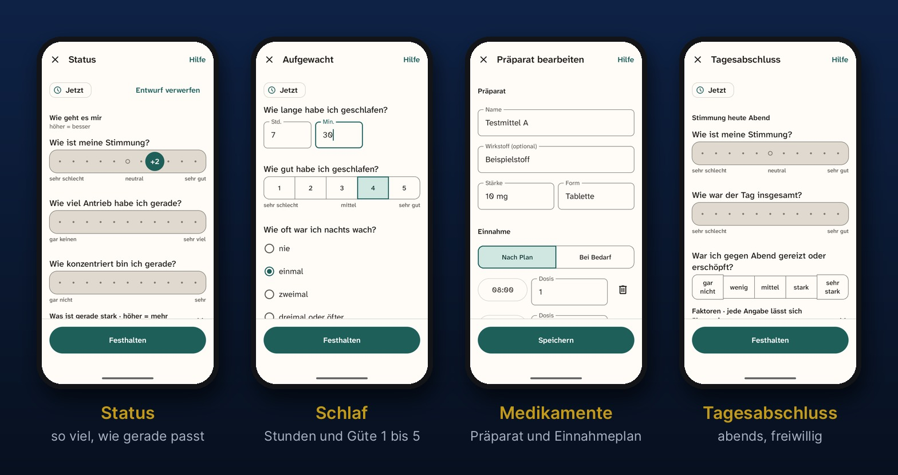
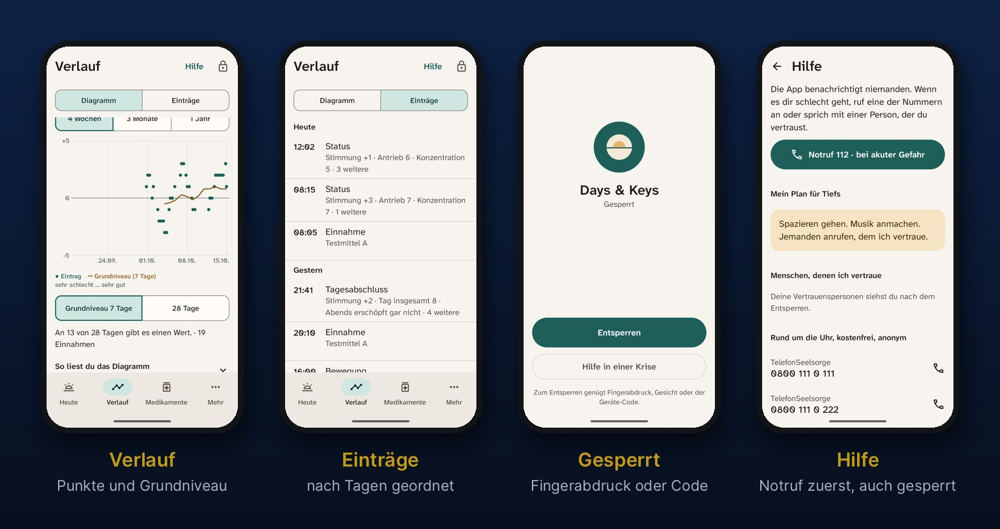

  

# Days & Keys

**Festhalten, wie es geht.** Days & Keys ist ein privates Tagebuch für das Handy. Es hält Stimmung,
Antrieb, Konzentration, Schlaf, Medikamente und besondere Ereignisse fest, so oft man mag, oft mit
einem einzigen Tipp. Über Wochen und Monate zeigt der Verlauf, wie es einem ging, und ein
Arzttermin lässt sich mit echten Aufzeichnungen vorbereiten statt aus dem Gedächtnis. Alles bleibt verschlüsselt auf dem eigenen Gerät.

> **Stand:** Testphase. Die Android-App lässt sich ausprobieren, die iPhone-Fassung folgt.

## Festhalten in Sekunden

  

- **Ein Tipp genügt:** Auf „Heute“ die Stimmung antippen und festhalten. Wer mehr angeben möchte,
  ergänzt Antrieb, Konzentration, Unruhe, Anspannung, Müdigkeit oder körperliche Beschwerden.
- **Schlaf am Morgen:** wie lange und wie gut, auf einer Skala von 1 bis 5.
- **Medikamente:** Präparate mit Einnahmeplan. Jede Einnahme wird bewusst bestätigt oder als
  ausgelassen vermerkt, nie automatisch. Ein Dosiswechsel erscheint später im Verlauf.
- **Ereignisse mit einem Tipp:** Bewegung, Mahlzeit, Arzttermin, Therapiesitzung, Belastung oder
  Konflikt und mehr, jeweils mit der Uhrzeit.
- **Tagesabschluss und Wochenrückblick:** abends und einmal pro Woche, freiwillig.
- **Nichts geht verloren:** Angefangene Einträge bleiben als Entwurf erhalten, auch wenn sich die
  App zwischendurch sperrt.

## Zurückschauen und geschützt bleiben

  

- **Verlauf:** jede Frage über vier Wochen, drei Monate oder ein Jahr, dazu das Grundniveau über
  sieben oder 28 Tage. Tage ohne Eintrag bleiben einfach Lücken. Die App bewertet nichts, stellt
  keine Diagnosen und gibt keine Empfehlungen.
- **Einträge:** nach Tagen geordnet, jederzeit zu korrigieren oder zu löschen. Auf Wunsch lassen
  sich alle Einträge als Tabelle exportieren, zum Beispiel für einen Arzttermin.
- **Hilfe in schweren Momenten:** Notruf und kostenfreie Beratungsnummern sind immer erreichbar,
  auch bei gesperrter App. Dazu ein eigener Plan für Tiefs und Menschen, denen man vertraut. Auf
  Wunsch zeigt die App den Plan von selbst, wenn die Stimmung mehrere Tage niedrig ist. Die App
  benachrichtigt niemanden.
- **Gemacht für Tage mit wenig Konzentration:** kurze Wege, große Schaltflächen, gut lesbare
  Schrift, auch bei sehr großer Schrifteinstellung.

## Privat bleibt privat

- **Kein Konto, kein Server, kein Internet:** Die App hat keinen Netzzugriff. Die Einträge
  verlassen das Gerät nur verschlüsselt als Sicherung oder als Export, wenn man ihn ausdrücklich
  anstößt. Blackfort sieht nichts davon.
- **Verschlüsselt und gesperrt:** Geöffnet wird die App mit Fingerabdruck, Gesicht oder Geräte-Code,
  nach kurzer Zeit sperrt sie sich wieder. Wer den Geräte-Code kennt, kann sie also öffnen.
  Bildschirmfotos der App sind gesperrt.
- **Neutrale Erinnerungen:** Die Benachrichtigungen nennen keine Medikamente und keine Inhalte.
- **Sicherung in einen eigenen Ordner:** Die App legt verschlüsselte Sicherungen in einen selbst
  gewählten Ordner, auch in eine eigene Cloud. Mit 24 Recovery-Wörtern auf Papier kommt alles auf
  ein neues Gerät. Die Wörter gibt es erst, wenn die Sicherung eingerichtet wird; der Einstieg kommt
  ohne sie aus.

> Days & Keys ist ein persönliches Tagebuch. Es ersetzt keine ärztliche Beratung, Diagnose oder
> Behandlung. In einer akuten Krise: Notruf 112 oder die TelefonSeelsorge unter 0800 111 0 111.

## Ausprobieren

- **Android:** Die aktuelle Testversion liegt unter
  [Releases](https://github.com/Blackfort-Technology/days-and-keys/releases) als APK, mit
  Prüfsumme. Beim Öffnen fragt Android einmal, ob Installationen aus dieser Quelle erlaubt sind.
  Für automatische Updates eignet sich die freie App [Obtainium](https://github.com/ImranR98/Obtainium)
  mit der Adresse dieses Repositorys.
- **iPhone:** in Vorbereitung.

Die Bildschirmfotos stammen aus einem Test im Emulator, alle Werte und das Präparat „Testmittel A“
sind erfunden.

---

## Technik und Entwicklung

Eine App, mit der eine Person ihren **Status jederzeit festhält**: Befinden, Konzentration,
Medikation und Substanzkonsum, so oft sie will, auch mehrmals am Tag. Die Fragen stehen in
Formularen, die jede Person selbst anpassen kann, und die App zeigt den Verlauf über Stunden,
Wochen und Monate. Alles ist auf dem Gerät verschlüsselt; die Schlüssel bleiben bei der Person,
die die App nutzt. Später sollen einzelne Felder gezielt und widerrufbar freigegeben werden können.

Status: **Prototyp** (Milestone M0/M1a). Der Kryptokern `dak-core` steht unter `core/`
(`docs/prototyp-kern.md`), die Apps entstehen unter `android/` und `ios/`.

- **Gesamtkonzept:** `docs/gesamtkonzept.md`
- **Architektur:** `docs/architektur.md`, alle Architekturentscheidungen (AE-01 bis AE-40) mit
  Status; Recherchen in `docs/architektur/`
- **Erörterungen:** drei Erörterungen vom 2026-10-06 (nicht öffentliches Archiv; Befunde als
  Issues)
- **Protokoll:** `docs/protokoll.md` (Teil A, M1), `docs/protokoll-freigaben.md` (Teil B, M1.5)

### Ausbaustufen

1. **M1a Gehgerüst und Nutzungsversuch:** ein schreibendes Gerät je Person; Status jederzeit mit
   vollem Fragenkatalog, Ereignisse mit einem Tipp, Medikation, Tages- und Wochenrückblick, Verlauf,
   Hilfe, automatische verschlüsselte Sicherung ohne Server. Mit diesem Stand beginnt der
   Nutzungsversuch von vier bis sechs Wochen (#82).
   **M1b Ausbau während des Versuchs:** Formulareditor, Substanzen hochsensibel, Arzt-PDF,
   Zufallsabfragen, Vorher/Nachher, Export.
2. **M1.5 Freigaben und Mehrgeräte:** nur wenn der Nutzungsversuch den Bedarf zeigt; eigenes
   Protokollpaket mit eigener Prüfung.
3. **M2 Erweiterter Alltag:** Wetter, allgemeine Mustererkennung, weitere Vorlagen.
4. **M3 Anbindung von Apps und Datenquellen:** Standort, Health Connect / HealthKit, Kalender.

### Zielbild M1

- **Anpassbare Formulare** (#6): Fragen ein- und ausblenden, ergänzen, umbenennen. Ändert sich
  Bedeutung oder Skala einer Frage, entsteht eine neue Messreihe.
- **Status jederzeit** (`docs/vorlagen.md`): „Status jetzt" auf einem Bildschirm (Dauer wird im
  Prototyp gemessen), zugeklappt „seit dem letzten Status", Ereignisse mit einem Tipp (Einnahme, Substanz,
  Mahlzeit, Schlaf, Krise …), Tagesabschluss und Wochenrückblick; optional zufällige Abfragen
  gegen die Verzerrung, nur in schlechten Momenten einzutragen.
- **Medikation** (#21): Präparat, Dosis, Einnahmeplan; Einnahmen werden ausdrücklich bestätigt,
  nie vorbelegt. Dosis- und Präparatwechsel sind Ereignisse im Verlauf.
- **Substanzkonsum** (#26, M1b): Alkohol und weitere Substanzen, hochsensibel: Eintragen ohne PIN,
  Lesen nur mit eigener App-PIN, im Arzt-PDF nur auf Wunsch.
- **Entsperren:** Geräteauthentifizierung (Biometrie oder Geräte-Code) genügt für die
  Gesundheitsdaten (#99); wer den Geräte-Code kennt, kann sie lesen.
- **Verläufe** (#23): mit Fallzahl und fehlenden Tagen, Dosiswechsel als neutrale
  Gegenüberstellung; keine automatischen Zusammenhänge, keine Empfehlungen, keine Diagnosen.
- **Arzt-PDF** (#36) und **verschlüsselte Sicherung** (#79) nur nach nativer Bestätigung.
- **Hilfe** jederzeit erreichbar (#71).
- **Für Menschen mit Konzentrationsschwierigkeiten gestaltet:** kurze Erfassung, Lücken ohne Strafe, Erinnerungen lokal und neutral.

### Architektur

| Baustein | Entscheidung |
|---|---|
| Server | In M1 keiner nötig; höchstens Speicher für die verschlüsselte Sicherung. Ab M1.5 eigene schlanke API, die nur Chiffretext sieht; Etebase wurde geprüft und verworfen (#2, `docs/unterbau-etebase.md`). |
| Clients | Entschieden (`docs/architektur.md` AE-04): native Oberflächen mit Jetpack Compose und SwiftUI über UniFFI an `dak-core`, keine WebView. Desktop später. Keine reine Web-App: ein Server, der den Code bei jedem Aufruf ausliefert, könnte einen Client unterschieben. |
| Kryptokern | **`dak-core` in Rust** mit libsodium, über UniFFI an die nativen Apps gebunden. Geheime Schlüssel, Formate und Autorisierung liegen nur dort; die App hat keinen Netzzugang, sensible Aktionen brauchen eine native Bestätigung (#32, `docs/protokoll.md` Abschnitt 13). |
| Krypto | libsodium (Versionen und Audits in `AUDITS.md`), Suite-Kennung je Objekt. Jeder Datensatz mit eigenem Schlüssel, umhüllt je Schutzklasse und Schlüsselgeneration; Rotation bei Wiederherstellung und neuen Recovery-Wörtern; hochsensible Einträge schreibbar ohne PIN, lesbar nur mit PIN; Recovery mit getrenntem Signatur- und Verschlüsselungsschlüssel; kein Freigabeformat auf Vorrat (`docs/protokoll.md` v0.6). |
| Freigaben (M1.5) | eigenes Format mit eigener Prüfung (`docs/protokoll-freigaben.md`); vor der ersten Freigabe lokale Umschlüsselung. |
| Widerruf (M1.5) | neue Schreibgeneration, Nachträge nie in geschlossene Generationen; was ein Empfänger schon hatte, kann er behalten, die App sagt das offen. |
| iOS-Bau | macOS-Runner von GitHub Actions, Signatur nur im Release-Lauf (#8, AE-30). Verteilung über TestFlight. |
| Android | APK und AAB aus der CI (GitHub Actions), das AAB in die interne Testspur von Google Play (#159, `docs/play-store.md`), später F-Droid mit reproduzierbarem Build (#9). |

### Leitplanken

1. **Kein Generalschlüssel.** Weder für Eltern noch für Administratoren noch für den Betreiber.
2. **Jede Person hält ihren eigenen Status fest.** Freigaben sind feldgenau und gehen vom Autor aus.
   Die App ist kein Werkzeug, um andere zu beobachten.
3. **Gesundheitsdaten verlassen das Gerät nur verschlüsselt** (Art. 9 DSGVO). Keine
   Auswertung durch fremde Cloud-Dienste.
4. **Ehrlich zu den Grenzen:** Korrelationen nur mit Fallzahl, Widerruf ohne falsche Versprechen,
   Hinweis auf Wechselwirkungen ohne eigenen medizinischen Rat.
5. **Krypto nicht selbst erfinden:** bewährte Bausteine, Protokoll vor dem Code spezifiziert
   und durch ein Bedrohungsmodell geprüft.
6. **Keine Kontrollfunktionen:** keine Lesebestätigungen, kein „zuletzt angesehen", keine
   Funktion „Zugriff anfordern", keine Meldung an Empfänger, wenn ein Eintrag fehlt (#41).
7. **Gesundheitsdaten verlassen das Gerät auch nicht über Umwege:** Erinnerungen lokal und mit
   neutralem Text, Spracherkennung nur offline, keine Cloud-Auswertung.
8. **Erst Nutzen belegen, dann Komplexität bauen:** Freigaben und Mehrgeräte erst nach einem
   Nutzungsversuch, der den Bedarf zeigt (#82).

### Name und Adresse

„Days & Keys". Der Server läuft unter `daysandkeys.wirdsichtbar.de` (#14), eigene Domains
werden vorerst nicht registriert. Am 2026-10-06 waren `daysandkeys.com/.de/.app/.eu` frei und
im DPMAregister (DE, EU, IR, alle Klassen) gab es keine Treffer. Ähnlich: die App „KeyDays"
(Tageszähler, nicht als Marke eingetragen). Vor einer Veröffentlichung neu prüfen.

### Bauen

- Kern: `cd core && cargo test --locked` (Toolchain aus `core/rust-toolchain.toml`).
- Android: Kern mit `cargo ndk -t arm64-v8a -t x86_64 -P 30 -o ../android/app/src/main/jniLibs build --release -p dak-ffi`,
  dann `cd android && gradle assembleDebug` (Gradle 9.7, Android SDK 37, NDK 29). Die genauen Schritte
  stehen in `.github/workflows/ci.yml`, Job `android`.
- iOS: nur auf macOS; die CI baut den Kern als XCFramework, erzeugt das Projekt mit XcodeGen
  (`ios/project.yml`) und baut für den Simulator (Job `ios`). TestFlight über
  `.github/workflows/release.yml`, sobald das Apple-Konto steht (#10).
- Testversionen für Android: signierte APK unter den Releases dieses Repos; über Google Play in der
  internen Testspur, sobald das Play-Konto eingerichtet ist (`docs/play-store.md`, #159).

### Lizenz

Kern und Apps stehen unter der Mozilla Public License 2.0 (`LICENSE`), der Server ab M1.5 unter
der GNU Affero General Public License 3.0, Dokumentation und Fragenvorlagen unter CC BY 4.0
(`LICENSE-docs`). Entscheidung AE-02.

### Mitarbeit

Siehe `CLAUDE.md` und `ROADMAP.md`. Issues und Bugs als GitHub-Issues, jeder Commit referenziert
ein Issue, jede Änderung läuft über die CI-Pipeline (GitHub Actions).
