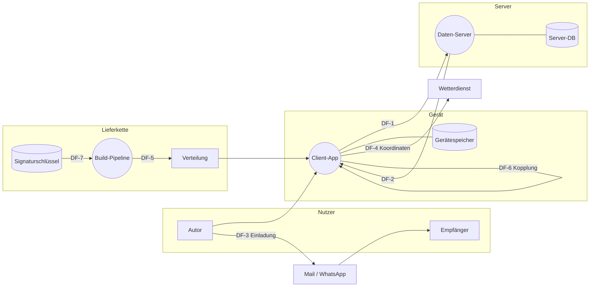

# Bedrohungsmodell: Days & Keys (Konzept, Protokoll v0.1)

**Umfang:** Zero-Knowledge-Tagebuch: Client-Apps (Capacitor/Tauri), Daten-Server unter daysandkeys.wirdsichtbar.de, Einladungs- und Freigabeprotokoll, Gerätekopplung und Recovery, Wetterabruf, Build- und Verteilkette. Grundlage ist ausschließlich die Spezifikation, Code gibt es noch nicht.  
**Methodik:** STRIDE-per-Element auf DFD, Risiko als Likelihood × Impact (3×3-Matrix), adversarischer Selbst-Review  
**Gegenstand:** `Protokoll v0.1 (frühere Historie)`  
**Analyst:** Claude Code · **Stand:** 2026-10-06 · **Version:** 0.3 (T-15/M-25 nach Protokoll v0.3, T-29 bis T-31 und M-26 bis M-28 aus der Konzeptprüfung; Belege gegen Protokoll v0.1)

## Zusammenfassung

31 Bedrohungen identifiziert - **0 kritisch**, 9 hoch, 11 mittel, 11 niedrig.

Nach Umsetzung der P1-Maßnahmen (M-1, M-5, M-12, M-13, M-14, M-20, M-25, M-26, M-27, M-28) bleiben keine hohen Restrisiken; T-15 bleibt bei mittel, weil kompromittierter WebView-Code angezeigte Klartexte und im aktuellen Autorisierungszustand erlaubte Daten gefährden kann. Akzeptiert sind: Kopien beim kompromittierten Server nach einem Widerruf (T-4), Beweisbarkeit signierter Einträge (T-17), Sichtbarkeit verschickter Einladungen (T-21) und manipulierte Wetterdaten (T-23). Größte Hebel vor dem ersten Code: Gerätewiderruf (M-12), Feld-Hashes statt Längen (M-5) und Einladung ohne Webseite mit Skript (M-1).

## Annahmen

- libsodium ist korrekt implementiert und wird korrekt aufgerufen; Implementierungsfehler im späteren Code sind nicht Teil dieses Modells.
- Die Betriebssysteme der Geräte (iOS 26, Android 16) sind aktuell und nicht gerootet bzw. gejailbreakt.
- Der Server-Betreiber (Blackfort Technology) ist vertrauenswürdig, der Server selbst kann aber kompromittiert oder zur Herausgabe gezwungen werden.
- Der Testkreis ist geschlossen; es gibt keine Selbstregistrierung Fremder.
- TLS zum Server ist korrekt konfiguriert; Vertraulichkeit hängt trotzdem nicht davon ab, weil Inhalte Ende-zu-Ende verschlüsselt sind.

## Außerhalb des Umfangs

- Implementierungsfehler im noch nicht geschriebenen Code (Gegenstand eines späteren Code-Reviews).
- Physische Angriffe auf die Hardware-Schlüsselspeicher der Geräte.
- Etebase: in #2 als Unterbau verworfen (docs/unterbau-etebase.md); modelliert ist die eigene schlanke API.
- Health Connect, HealthKit, Kalender und OwnTracks (M2); sie werden mit #11 und #12 nachmodelliert.

## Sicherheitsrelevante Abhängigkeiten

- libsodium (libsodium-wrappers bzw. native Bindings)
- Capacitor, Tauri und deren Plugins (npm-Lieferkette)
- Apple App Store Connect, TestFlight, Cloud-Builddienst für iOS
- F-Droid bzw. APK aus der CI, Signaturschlüssel im Secret-Store
- Open-Meteo bzw. Bright Sky (Wetter)
- WhatsApp/Mail als Einladungskanal

## Schützenswerte Güter (Assets)

| ID | Asset | Typ | Sensitivität | Beschreibung |
|---|---|---|---|---|
| AS-1 | Tagebuchinhalte inkl. Gesundheitsdaten (Medikation, Alkohol, Stimmung) | data | critical | Besondere Kategorie nach Art. 9 DSGVO, zusätzlich beziehungssensibel. |
| AS-2 | Schlüsselmaterial (IK_sig, IK_enc, KK, Kettenschlüssel, Recovery-Schlüssel) | credential | critical | Wer es hat, liest alles und kann als Autor schreiben. |
| AS-3 | Metadaten (wer teilt mit wem, Zeitpunkte, Epochen, Größen, IP-Adressen) | data | high | Erlauben Rückschlüsse auf Gewohnheiten und Beziehungen, auch ohne Inhalte. |
| AS-4 | Standort (für Wetter und später OwnTracks) | data | high |  |
| AS-5 | Integrität der ausgelieferten App (Binary, Signatur) | function | critical | Eine manipulierte App hebelt jede Ende-zu-Ende-Verschlüsselung aus. |
| AS-6 | Verfügbarkeit des Tagebuchs | availability | medium |  |
| AS-7 | Vertrauen der Nutzer untereinander | reputation | high | Die App darf sich nicht wie ein Kontrollwerkzeug anfühlen (README, Leitplanke 2). |

## Akteure & Vertrauensstufen

| ID | Akteur | Typ | Vertrauen | Beschreibung |
|---|---|---|---|---|
| AC-1 | Autor (führt das Tagebuch) | human | authenticated |  |
| AC-2 | Empfänger mit Freigabe | human | authenticated | Darf freigegebene Felder lesen, sonst nichts. |
| AC-3 | Angreifer mit Kontrolle über den Server | external | admin | Kompromittierter oder zur Herausgabe gezwungener Server. |
| AC-4 | Mitleser auf dem Einladungskanal | external | untrusted | Zugriff auf Mail-Postfach, WhatsApp-Backup oder entsperrtes Handy. |
| AC-5 | Person mit Zugriff auf ein entsperrtes oder verlorenes Gerät | insider | untrusted | Dieb, Finder oder eine nahestehende Person, die zum Entsperren drängt. |
| AC-6 | Angreifer in der Lieferkette (Build-Dienst, npm-Paket, Signaturschlüssel) | external | privileged |  |
| AC-7 | Drittdienst Wetter | system | untrusted |  |

## Datenflussdiagramm (DFD) & Trust Boundaries

**Trust Boundaries:**

- **TB-1 Gerät ↔ Server** - Alles jenseits dieser Grenze gilt als potenziell feindlich (Zero-Knowledge-Annahme).
- **TB-2 App ↔ Fremdkanal**
- **TB-3 Gerät ↔ Drittdienst**
- **TB-4 Lieferkette ↔ Gerät**
- **TB-5 Build-Infrastruktur ↔ Cloud-Builddienst**

**Elemente:**

| ID | Element | Typ | Fluss/Zone | Evidenz |
|---|---|---|---|---|
| EE-1 | Autor | external_entity | Nutzer | README.md:5-6 |
| EE-2 | Empfänger | external_entity | Nutzer | docs/protokoll.md:143-156 |
| EE-3 | Einladungskanal (Mail, WhatsApp) | external_entity | Fremdkanal | docs/protokoll.md:193-194 |
| EE-4 | Wetterdienst (Open-Meteo / Bright Sky) | external_entity | Drittdienst | README.md:18 |
| EE-5 | Verteilung (TestFlight, F-Droid / APK) | external_entity | Lieferkette | README.md:35-36 |
| PR-1 | Client-App (Capacitor auf Android/iOS, Tauri) | process | Gerät | README.md:31; CLAUDE.md:24-25 |
| PR-2 | Daten-Server (API daysandkeys.wirdsichtbar.de) | process | Server | docs/protokoll.md:151-156; README.md:30 |
| PR-3 | Build-Pipeline (CI + macOS-Cloud-Dienst) | process | Lieferkette | README.md:35 |
| DS-1 | Gerätespeicher (gewrappte Schlüssel, entschlüsselter Cache) | data_store | Gerät | docs/protokoll.md:54-58 |
| DS-2 | Server-Datenbank | data_store | Server | docs/protokoll.md:177-185 |
| DS-3 | Signaturschlüssel im Secret-Store bzw. beim Cloud-Dienst | data_store | Lieferkette | README.md:35-36 |
| DF-1 | Client → Server: Einträge, Freigaben, Schlüsselbund, Löschanweisungen | data_flow | PR-1→PR-2 ⚡TB-1 | docs/protokoll.md:113-122 |
| DF-2 | Server → Client: Chiffrate, Freigaben, öffentliche Schlüssel | data_flow | PR-2→PR-1 ⚡TB-1 | docs/protokoll.md:124-130 |
| DF-3 | Autor → Empfänger: Einladungslink | data_flow | EE-1→EE-3 ⚡TB-2 | docs/protokoll.md:191-199 |
| DF-4 | Client → Wetterdienst: Koordinaten | data_flow | PR-1→EE-4 ⚡TB-3 | README.md:18 |
| DF-5 | Pipeline → Verteilung → Gerät: App-Binary | data_flow | PR-3→EE-5 ⚡TB-4 | README.md:35-36 |
| DF-6 | Altes Gerät → neues Gerät: Gerätekopplung | data_flow | PR-1→PR-1 ⚡TB-1 | docs/protokoll.md:180-182 |
| DF-7 | Secret-Store → Cloud-Builddienst: Signaturzertifikat | data_flow | DS-3→PR-3 ⚡TB-5 | README.md:35 |

## Bedrohungsregister (nach Risiko)

### T-1 - Einladungsseite auf dem Datenserver kann den Code aus dem URL-Fragment auslesen  `HIGH`

- **STRIDE:** Information Disclosure (I) · **Element:** DF-3 · **Likelihood/Impact:** medium/high · **Restrisiko:** high
- **Betroffene Assets:** AS-2, AS-1, AS-7
- **Taxonomie:** CWE-200, CWE-829

Der Einladungslink zeigt auf eine Seite des Datenservers. Öffnet der Empfänger ihn im Browser statt in der App, kann JavaScript dieser Seite das Fragment (#code) lesen. Damit fällt der Schutz aus Schritt 3 der Einladung, und es entsteht genau der vom Server ausgelieferte Code, den Invariante 3 verbietet.

**Angriffsweg:** Kompromittierter Server liefert unter /e/<id> eine Seite mit Skript, das location.hash ausliest, selbst den HMAC berechnet und eigene Schlüssel als Empfänger anmeldet.

**Evidenz:**
- _Doku_ `docs/protokoll.md:193-194` - Link auf daysandkeys.wirdsichtbar.de mit Code im Fragment
- _Doku_ `CLAUDE.md:24-25` - Invariante: kein Code vom Datenserver
- _Fehlende Kontrolle_ `docs/protokoll.md:189-206` - Es ist nicht festgelegt, dass der Link nur von der App (Universal Links / App Links) geöffnet wird und die Webseite kein Skript enthält

**Vorhandene Kontrollen:** HMAC über die öffentlichen Schlüssel, Bestätigung durch den Autor (protokoll.md:195-199)

**Maßnahmen:** M-1

### T-5 - Empfänger erfährt Zahl und Größe nicht freigegebener Felder  `HIGH`

- **STRIDE:** Information Disclosure (I) · **Element:** DF-2 · **Likelihood/Impact:** high/medium · **Restrisiko:** high
- **Betroffene Assets:** AS-3, AS-7
- **Taxonomie:** CWE-203

Damit der Umschlag nachrechenbar bleibt, bekommt der Empfänger zu nicht freigegebenen Feldern Feld-ID und Länge. Er sieht also, dass es Felder gibt, die ihm verborgen bleiben, und wann sie befüllt werden. In einer Beziehung kann das allein Misstrauen auslösen.

**Angriffsweg:** Empfänger zählt je Tag die fremden Feld-IDs und deren Größen und schließt daraus z. B. auf eine verborgene Medikations- oder Alkoholerfassung.

**Evidenz:**
- _Doku_ `docs/protokoll.md:126-130` - Server liefert (feld_id, Länge) nicht freigegebener Felder, als offener Punkt markiert

**Maßnahmen:** M-5

### T-13 - Verlorenes oder entsperrtes Gerät gibt das ganze Konto preis, ein Gerät lässt sich nicht einzeln sperren  `HIGH`

- **STRIDE:** Information Disclosure (I) · **Element:** DS-1 · **Likelihood/Impact:** medium/high · **Restrisiko:** high
- **Betroffene Assets:** AS-1, AS-2, AS-7
- **Taxonomie:** CWE-320

Alle Geräte teilen dieselben Identitätsschlüssel und denselben KK. Wer ein entsperrtes Gerät hat, liest alles und kann als Autor schreiben. Es gibt keinen Weg, nur dieses Gerät auszusperren; der Autor müsste ein neues Konto anlegen.

**Angriffsweg:** Gestohlenes Handy mit entsperrter App, oder eine nahestehende Person drängt zum Entsperren.

**Evidenz:**
- _Doku_ `docs/protokoll.md:180-182` - Neues Gerät bekommt IK_sig, IK_enc und KK
- _Doku_ `docs/protokoll.md:26` - Nicht-Ziel: entsperrtes, kompromittiertes Gerät
- _Fehlende Kontrolle_ `docs/protokoll.md:175-187` - Keine Geräteschlüssel, kein Gerätewiderruf, keine Schlüsselrotation nach Geräteverlust

**Vorhandene Kontrollen:** Hardware-Wrapping und Biometrie (protokoll.md:54-58)

**Maßnahmen:** M-12, M-13

### T-14 - Entschlüsselter Cache auf dem Gerät nicht geschützt  `HIGH`

- **STRIDE:** Information Disclosure (I) · **Element:** PR-1 · **Likelihood/Impact:** medium/high · **Restrisiko:** high
- **Betroffene Assets:** AS-1
- **Taxonomie:** CWE-312, CWE-532

Die App hält entschlüsselte Werte für die Auswertung. Wie dieser Cache geschützt ist, legt die Spezifikation nicht fest. Er kann in Backups (iCloud, Google), Screenshots im App-Umschalter oder Logs landen.

**Angriffsweg:** Unverschlüsseltes Geräte-Backup oder Vorschaubild im App-Umschalter zeigt Medikation.

**Evidenz:**
- _Fehlende Kontrolle_ `docs/protokoll.md:54-58` - Nur die Schlüssel sind als verschlüsselt beschrieben, nicht der Klartext-Cache

**Maßnahmen:** M-13

### T-15 - Kompromittierter WebView-Code (z. B. bösartiges npm-Paket) greift auf Schlüssel oder die Bridge zu  `HIGH`

- **STRIDE:** Elevation of Privilege (E) · **Element:** PR-1 · **Likelihood/Impact:** medium/high · **Restrisiko:** medium
- **Betroffene Assets:** AS-2, AS-1, AS-5
- **Taxonomie:** CWE-1357, CWE-506, CWE-285

Die Oberfläche läuft als TypeScript in der WebView. Eine kompromittierte Abhängigkeit hat dort vollen Zugriff. Liegen Schlüssel in der WebView, kann sie sie auslesen. Liegen sie nativ, kann sie die Bridge missbrauchen: entschlüsseln, ausleiten, Freigaben oder Exporte anstoßen.

**Angriffsweg:** Übernommenes npm-Paket ruft beim Start entry.open für alle Einträge auf und schickt die Ergebnisse an einen fremden Server, oder ruft grant.create für einen eigenen Kontakt auf.

**Evidenz:**
- _Doku_ `README.md:31` - Oberfläche als TypeScript-Codebasis in Capacitor/Tauri
- _Doku_ `SECURITY.md:10-13` - Security-Suite inkl. SBOM und Trivy im Build
- _Fehlende Kontrolle_ `docs/protokoll.md:1-6` - Protokoll v0.1 legt nicht fest, wo Schlüssel und Autorisierung liegen; nachgezogen in v0.3 Abschnitt 13

**Vorhandene Kontrollen:** CI-Sicherheitsprüfungen mit Dependency-Check, Trivy, SBOM (SECURITY.md:10-13)

**Maßnahmen:** M-14, M-25

### T-22 - Wetterdienst erfährt täglich den Standort  `HIGH`

- **STRIDE:** Information Disclosure (I) · **Element:** DF-4 · **Likelihood/Impact:** high/medium · **Restrisiko:** high
- **Betroffene Assets:** AS-4
- **Taxonomie:** CWE-359

Für das Wetter schickt der Client Koordinaten an einen Drittdienst, zusammen mit der IP-Adresse. Über Monate ergibt das ein Bewegungsprofil.

**Angriffsweg:** Wetterdienst oder ein Angreifer bei ihm protokolliert Koordinaten und IP-Adressen.

**Evidenz:**
- _Doku_ `README.md:18` - Wetter auf dem Gerät abgerufen, Server erfährt den Ort nicht (#7)
- _Fehlende Kontrolle_ `README.md:18` - Keine Vorgabe zur Vergröberung der Koordinaten

**Maßnahmen:** M-20

### T-29 - Fremde Texte werden in der WebView als HTML ausgeführt (Cross-Site-Scripting)  `HIGH`

- **STRIDE:** Tampering (T) · **Element:** PR-1 · **Likelihood/Impact:** medium/high · **Restrisiko:** high
- **Betroffene Assets:** AS-1, AS-7
- **Taxonomie:** CWE-79, CWE-116, OWASP A03:2021

Feldbeschreibungen in Freigaben, geteilte Formularvorlagen und Kontaktnamen stammen von anderen Personen. Rendert die Oberfläche sie als HTML oder Markdown, läuft eingeschleustes Skript in der WebView und kann die Bridge im aktuellen Autorisierungszustand nutzen.

**Angriffsweg:** Ein Kontakt gibt ein Feld mit der Beschreibung  frei; beim Anzeigen der Freigabe läuft das Skript.

**Evidenz:**
- _Doku_ `docs/protokoll.md:137-139` - Feldbeschreibung (Name, Typ, Einheit) kommt mit der Freigabe vom Autor
- _Doku_ `docs/protokoll.md:145-148` - feldbeschreibung ist Teil des Freigabe-Inhalts
- _Fehlende Kontrolle_ `docs/protokoll.md:135-139` - Keine Regel, wie fremde Zeichenketten geprüft und dargestellt werden

**Vorhandene Kontrollen:** Signatur der Freigabe belegt nur die Herkunft, nicht die Harmlosigkeit

**Maßnahmen:** M-26

### T-30 - Benachrichtigungen verraten Medikation oder Konsum  `HIGH`

- **STRIDE:** Information Disclosure (I) · **Element:** PR-1 · **Likelihood/Impact:** high/medium · **Restrisiko:** low
- **Betroffene Assets:** AS-1, AS-3, AS-7
- **Taxonomie:** CWE-359

Erinnerungen mit Medikamentennamen erscheinen auf dem Sperrbildschirm und sind für jeden sichtbar, der aufs Handy schaut. Kämen sie als Push vom Server, sähen Apple bzw. Google Zeitpunkt und Inhalt.

**Angriffsweg:** Person am Tisch sieht auf dem gesperrten Handy „Präparat A nehmen“; oder Push-Inhalte liegen bei APNs/FCM.

**Evidenz:**
- _Doku_ `README.md:24` - Erinnerungen zum sinnvollen Zeitpunkt
- _Fehlende Kontrolle_ `README.md:24` - Keine Vorgabe zu Inhalt und Weg der Benachrichtigungen

**Maßnahmen:** M-27

### T-31 - Spracheingabe schickt Gesundheitsdaten an einen Cloud-Dienst  `HIGH`

- **STRIDE:** Information Disclosure (I) · **Element:** PR-1 · **Likelihood/Impact:** medium/high · **Restrisiko:** low
- **Betroffene Assets:** AS-1
- **Taxonomie:** CWE-359, CWE-201

Die geplante Spracheingabe mit LLM-Auswertung würde gesprochene Sätze über Medikation und Befinden im Klartext an einen Cloud-Dienst geben und damit die Ende-zu-Ende-Verschlüsselung umgehen.

**Angriffsweg:** Systemweite Online-Spracherkennung oder eine Cloud-LLM-API erhält jeden diktierten Eintrag.

**Evidenz:**
- _Doku_ `README.md:17` - Sprache statt Tippen, ein LLM überführt den Satz in Felder
- _Fehlende Kontrolle_ `README.md:17` - Keine Vorgabe, dass Erkennung und Auswertung auf dem Gerät laufen

**Maßnahmen:** M-28

### T-2 - Server tauscht öffentliche Schlüssel bei unverifizierten Kontakten aus  `MEDIUM`

- **STRIDE:** Spoofing (S) · **Element:** PR-2 · **Likelihood/Impact:** low/high · **Restrisiko:** medium
- **Betroffene Assets:** AS-1, AS-7
- **Taxonomie:** CWE-295

Freigaben an unverifizierte Kontakte sind erlaubt. Hat ein Angreifer zusätzlich zum Server auch den Einladungskanal (WhatsApp-Backup, Postfach), kann er bei der Einladung eigene Schlüssel einschleusen; alle Freigaben gehen dann an ihn.

**Angriffsweg:** AC-3 und AC-4 zusammen: Code aus dem Chat lesen, Einladung vor dem Empfänger einlösen, eigene Schlüssel melden. Der Autor sieht nur einen Namen, den der Angreifer frei wählt.

**Evidenz:**
- _Doku_ `docs/protokoll.md:200-204` - Sicherheitsnummer optional, Freigaben auch an unverifizierte Kontakte möglich

**Vorhandene Kontrollen:** Einmaligkeit und 48-Stunden-Frist der Einladung (protokoll.md:191-192); HMAC mit Einladungscode (protokoll.md:195-197)

**Maßnahmen:** M-2

### T-6 - Metadaten auf dem Server verraten Gewohnheiten und Beziehungen  `MEDIUM`

- **STRIDE:** Information Disclosure (I) · **Element:** DS-2 · **Likelihood/Impact:** medium/medium · **Restrisiko:** medium
- **Betroffene Assets:** AS-3, AS-4
- **Taxonomie:** CWE-359

Der Server kennt Freigabebeziehungen, Epochen, Upload-Zeitpunkte, aufgefüllte Größen und IP-Adressen. Regelmäßige Uploads zu festen Uhrzeiten (z. B. Medikation morgens) sind auch verschlüsselt erkennbar.

**Angriffsweg:** Wer die Datenbank und Zugriffslogs bekommt, rekonstruiert Tagesrhythmus, Orte über IP-Adressen und wer wem was freigibt.

**Evidenz:**
- _Doku_ `docs/protokoll.md:208-219` - Tabelle der sichtbaren Metadaten
- _Doku_ `docs/protokoll.md:24-25` - Nicht-Ziel: Verbergen, wer mit wem teilt

**Vorhandene Kontrollen:** Auffüllen auf Blockgrößen (protokoll.md:39); Gebündeltes Hochladen (protokoll.md:218-219)

**Maßnahmen:** M-6

### T-8 - Server verweigert Dienst oder löscht Daten  `MEDIUM`

- **STRIDE:** Denial of Service (D) · **Element:** PR-2 · **Likelihood/Impact:** medium/medium · **Restrisiko:** medium
- **Betroffene Assets:** AS-6, AS-1
- **Taxonomie:** CWE-400

Fällt der Server aus oder löscht ein Angreifer die Datenbank, sind Einträge, Freigaben und der Schlüsselbund weg, sofern kein Gerät eine vollständige Kopie hat.

**Angriffsweg:** Ransomware oder Fehlbedienung auf dem Server-Host; oder gezieltes Nichtausliefern einzelner Freigaben.

**Evidenz:**
- _Fehlende Kontrolle_ `docs/protokoll.md:175-187` - Keine Aussage, ob Geräte eine vollständige lokale Kopie halten oder wie Server-Backups laufen

**Maßnahmen:** M-8

### T-12 - Gerätekopplung: Angreifer koppelt eigenes Gerät  `MEDIUM`

- **STRIDE:** Spoofing (S) · **Element:** PR-1 · **Likelihood/Impact:** low/high · **Restrisiko:** medium
- **Betroffene Assets:** AS-2, AS-1
- **Taxonomie:** CWE-287

Bei der Kopplung gehen alle Identitätsschlüssel an das neue Gerät. Wer den QR-Code ersetzt oder der Nutzer zu einer Bestätigung drängt, bekommt das komplette Konto.

**Angriffsweg:** Server oder Angreifer mit Blick auf das Display tauscht den kurzlebigen Schlüssel aus; Prüfzahl wird ungeprüft bestätigt.

**Evidenz:**
- _Doku_ `docs/protokoll.md:180-182` - Kopplung per QR mit Prüfzahl, danach Übertragung von IK_sig, IK_enc, KK

**Vorhandene Kontrollen:** Prüfzahl auf beiden Geräten (protokoll.md:180-181)

**Maßnahmen:** M-11

### T-16 - Client akzeptiert gefälschte Freigaben oder Einträge  `MEDIUM`

- **STRIDE:** Spoofing (S) · **Element:** PR-1 · **Likelihood/Impact:** low/high · **Restrisiko:** medium
- **Betroffene Assets:** AS-1
- **Taxonomie:** CWE-347

Prüft die App Signaturen von Freigaben und Einträgen nicht konsequent, kann der Server Werte unterschieben.

**Angriffsweg:** Server legt einen Freigabe-Blob mit eigenem Schlüssel ab; App verwendet ihn ohne Signaturprüfung.

**Evidenz:**
- _Doku_ `docs/protokoll.md:145-150` - Freigaben werden signiert, dann versiegelt
- _Doku_ `docs/protokoll.md:124-127` - Empfänger prüfen Signatur und Hashkette

**Vorhandene Kontrollen:** Sign-then-seal, Signatur auf jedem Eintrag

**Maßnahmen:** M-15

### T-18 - Verfügbarkeit der App: Akku-Optimierung und Plattformgrenzen  `MEDIUM`

- **STRIDE:** Denial of Service (D) · **Element:** PR-1 · **Likelihood/Impact:** high/low · **Restrisiko:** medium
- **Betroffene Assets:** AS-6

Manche Hersteller beenden Hintergrund-Apps; Erinnerungen und Standort laufen dann nicht. Erfasste Daten fehlen.

**Angriffsweg:** Akku-Optimierung beendet die App, Upload und Erinnerungen bleiben aus.

**Evidenz:**
- _Doku_ `README.md:36` - Android-Verteilung, Hinweis auf Akku-Optimierung in Issue #9

**Maßnahmen:** M-17

### T-19 - Client wird zur Ausführung fremden Codes gebracht  `MEDIUM`

- **STRIDE:** Tampering (T) · **Element:** PR-1 · **Likelihood/Impact:** low/high · **Restrisiko:** medium
- **Betroffene Assets:** AS-2, AS-5
- **Taxonomie:** CWE-829, CWE-494

Lädt die WebView Inhalte nach (Remote-URL, Hot-Update-Plugins), kann der Server eigenen Code ausführen.

**Angriffsweg:** Capacitor-Konfiguration mit server.url oder ein Live-Update-Dienst lädt JavaScript vom Server.

**Evidenz:**
- _Doku_ `CLAUDE.md:24-25` - Invariante 3: kein Nachladen vom Datenserver
- _Fehlende Kontrolle_ `README.md:31` - Keine Festlegung zu CSP und zum Verbot von Live-Update-Plugins

**Vorhandene Kontrollen:** Invariante 3 in CLAUDE.md

**Maßnahmen:** M-18

### T-20 - Mitleser löst Einladung vor dem Empfänger ein  `MEDIUM`

- **STRIDE:** Spoofing (S) · **Element:** EE-3 · **Likelihood/Impact:** low/high · **Restrisiko:** medium
- **Betroffene Assets:** AS-1, AS-7
- **Taxonomie:** CWE-294

Der Code liegt im Chatverlauf und in Backups. Wer ihn liest, kann sich innerhalb von 48 Stunden als Empfänger anmelden.

**Angriffsweg:** WhatsApp-Backup in der Cloud oder geteiltes Postfach; Angreifer meldet sich unter dem erwarteten Namen an.

**Evidenz:**
- _Doku_ `docs/protokoll.md:205-206` - Mitleser kann Einladung vorher einlösen, Gegenmaßnahmen Laufzeit, Einmaligkeit, Bestätigung

**Vorhandene Kontrollen:** Einmaligkeit, 48 Stunden, Bestätigung durch den Autor (protokoll.md:191-199)

**Maßnahmen:** M-2

### T-24 - Kompromittierter Build-Dienst liefert manipulierte iOS-App  `MEDIUM`

- **STRIDE:** Tampering (T) · **Element:** PR-3 · **Likelihood/Impact:** low/high · **Restrisiko:** medium
- **Betroffene Assets:** AS-5, AS-2, AS-1
- **Taxonomie:** CWE-494

Der macOS-Cloud-Dienst baut und signiert die iOS-App. Wer ihn kontrolliert, kann eine App ausliefern, die Schlüssel ausleitet. iOS-Builds sind nicht reproduzierbar, eine Prüfung gegen den Quellcode ist schwer.

**Angriffsweg:** Übernahme des Kontos beim Cloud-Builddienst oder ein manipulierter Build-Schritt.

**Evidenz:**
- _Doku_ `README.md:35` - iOS-Bau über einen Cloud-Dienst (#8)

**Vorhandene Kontrollen:** Signaturzertifikat nur zur Bauzeit aus dem Secret-Store (README.md:35)

**Maßnahmen:** M-22

### T-25 - Signaturschlüssel abgegriffen  `MEDIUM`

- **STRIDE:** Information Disclosure (I) · **Element:** DS-3 · **Likelihood/Impact:** low/high · **Restrisiko:** medium
- **Betroffene Assets:** AS-5
- **Taxonomie:** CWE-522

Mit dem Android-Signaturschlüssel oder dem Apple-Zertifikat kann ein Angreifer Updates signieren, die als echt durchgehen.

**Angriffsweg:** Schlüssel bleibt nach dem Bau im Cloud-Dienst liegen oder wird aus einem CI-Workspace kopiert.

**Evidenz:**
- _Doku_ `README.md:35-36` - Signaturschlüssel im Secret-Store, Übergabe an den Bau

**Vorhandene Kontrollen:** Ablage im Secret-Store

**Maßnahmen:** M-22, M-23

### T-27 - Manipulation der App auf dem Verteilweg  `MEDIUM`

- **STRIDE:** Tampering (T) · **Element:** DF-5 · **Likelihood/Impact:** low/high · **Restrisiko:** low
- **Betroffene Assets:** AS-5
- **Taxonomie:** CWE-494

Eine APK außerhalb eines Stores kann auf dem Weg ausgetauscht werden.

**Angriffsweg:** Download einer APK über einen manipulierten Link.

**Evidenz:**
- _Doku_ `README.md:36` - APK aus der CI, später F-Droid

**Vorhandene Kontrollen:** Android prüft beim Update die Signatur gegen die installierte App

**Maßnahmen:** M-24

### T-3 - Server zeigt verschiedenen Empfängern verschiedene Log-Stände (Equivocation)  `LOW`

- **STRIDE:** Tampering (T) · **Element:** PR-2 · **Likelihood/Impact:** low/medium · **Restrisiko:** low
- **Betroffene Assets:** AS-1, AS-6
- **Taxonomie:** CWE-345

Die Hashkette erkennt Lücken nur innerhalb dessen, was ein Empfänger sieht. Ein Server kann einem Empfänger dauerhaft einen älteren oder verzweigten Log-Stand zeigen, etwa um einen Lösch-Eintrag oder eine neue Freigabe zu unterdrücken.

**Angriffsweg:** Server liefert Empfänger B den Log nur bis Nummer n und hält spätere Einträge zurück. B bemerkt nichts, weil kein späterer Eintrag ankommt.

**Evidenz:**
- _Doku_ `docs/protokoll.md:124-127` - Append-only-Log mit Hashkette, Prüfung nur durch den jeweiligen Empfänger
- _Fehlende Kontrolle_ `docs/protokoll.md:113-133` - Kein Abgleich des Log-Kopfes zwischen Empfängern oder mit dem Autor, keine Frischeangabe

**Vorhandene Kontrollen:** Signatur und Hashkette je Eintrag (protokoll.md:118-126)

**Maßnahmen:** M-3

### T-4 - Widerruf hängt für bereits geladene und serverseitig kopierte Daten vom Server ab  `LOW`

- **STRIDE:** Information Disclosure (I) · **Element:** DS-2 · **Likelihood/Impact:** low/medium · **Restrisiko:** low
- **Betroffene Assets:** AS-1, AS-7
- **Taxonomie:** CWE-404

Schritt 3 und 4 des Widerrufs löschen Chiffrate und Freigaben auf dem Server. Ein kompromittierter Server kann Kopien behalten und dem widerrufenen Empfänger weiter alte Chiffrate liefern, für die er die Schlüssel schon hat.

**Angriffsweg:** Server ignoriert die Löschanweisung und liefert R weiter Werte der Epochen vor w.

**Evidenz:**
- _Doku_ `docs/protokoll.md:166-172` - Löschen auf dem Server, rückwirkend nur durch Neuverschlüsselung
- _Doku_ `docs/protokoll.md:22-23` - Nicht-Ziel: Schutz dessen, was ein Empfänger schon gesehen hat

**Vorhandene Kontrollen:** Neue Kette ab Epoche w, neue Daten für R unlesbar (protokoll.md:162-165)

**Maßnahmen:** M-4

### T-7 - Fehlerhafte Zugriffskontrolle liefert fremde Chiffrate und Metadaten aus  `LOW`

- **STRIDE:** Elevation of Privilege (E) · **Element:** PR-2 · **Likelihood/Impact:** medium/low · **Restrisiko:** low
- **Betroffene Assets:** AS-3
- **Taxonomie:** CWE-639, OWASP A01:2021

Die Zugriffskontrolle auf dem Server ist die zweite Linie. Ein Fehler darin (Objekt-ID statt Prüfung der Freigabe) liefert fremde Chiffrate aus. Inhalte bleiben verschlüsselt, Metadaten und Log-Struktur werden sichtbar.

**Angriffsweg:** Angemeldeter Nutzer fragt Einträge eines fremden Autors per ID ab.

**Evidenz:**
- _Doku_ `docs/protokoll.md:151-156` - Server liefert nur freigegebene Chiffrate aus (Zugriffskontrolle als zweite Linie)
- _Fehlende Kontrolle_ `docs/protokoll.md:208-219` - Keine Spezifikation der serverseitigen Berechtigungsprüfung je Objekt

**Vorhandene Kontrollen:** Ende-zu-Ende-Verschlüsselung der Inhalte

**Maßnahmen:** M-7

### T-9 - Server-Datenbank wird gelöscht, verändert oder zurückgespielt  `LOW`

- **STRIDE:** Tampering (T) · **Element:** DS-2 · **Likelihood/Impact:** low/medium · **Restrisiko:** low
- **Betroffene Assets:** AS-1, AS-7
- **Taxonomie:** CWE-345

Ein Angreifer spielt einen alten Datenbankstand ein. Ein Widerruf ist dann scheinbar nie passiert, alte Freigabe-Blobs liegen wieder aus.

**Angriffsweg:** Rückspielen eines Backups vor dem Widerruf; Empfänger R bekommt seine gelöschte Freigabe wieder ausgeliefert.

**Evidenz:**
- _Doku_ `docs/protokoll.md:166-167` - Widerruf löscht Freigabe-Einträge serverseitig
- _Fehlende Kontrolle_ `docs/protokoll.md:158-173` - Keine signierte Widerrufsliste, die der Client prüft

**Vorhandene Kontrollen:** Neue Kette nach Widerruf, Daten ab w sind für R ohnehin unlesbar (protokoll.md:162-163)

**Maßnahmen:** M-9

### T-10 - Nachträgliches Abstreiten von Server-Aktionen  `LOW`

- **STRIDE:** Repudiation (R) · **Element:** DS-2 · **Likelihood/Impact:** low/low · **Restrisiko:** low
- **Betroffene Assets:** AS-7
- **Taxonomie:** CWE-778

Löschungen und Auslieferungen auf dem Server sind nicht nachvollziehbar protokolliert. Nach einem Vorfall lässt sich nicht klären, ob der Server eine Löschanweisung umgesetzt hat.

**Angriffsweg:** Streit, ob ein widerrufener Empfänger nach dem Widerruf noch Daten geladen hat.

**Evidenz:**
- _Fehlende Kontrolle_ `docs/protokoll.md:158-173` - Kein Ereignisprotokoll für Widerruf und Auslieferung

**Vorhandene Kontrollen:** Signierte Löschanweisung des Autors (protokoll.md:166)

**Maßnahmen:** M-10

### T-11 - Manipulation der Daten auf dem Weg zum Server  `LOW`

- **STRIDE:** Tampering (T) · **Element:** DF-1 · **Likelihood/Impact:** low/low · **Restrisiko:** low
- **Betroffene Assets:** AS-1
- **Taxonomie:** CWE-345

Ein Angreifer im Netz oder auf dem Server verändert Chiffrate, Freigaben oder Löschanweisungen.

**Angriffsweg:** Austausch eines Chiffrats gegen ein älteres desselben Feldes.

**Evidenz:**
- _Doku_ `docs/protokoll.md:107-111` - AEAD mit Associated Data bindet Wert an Eintrag, Feld, Kette und Epoche
- _Doku_ `docs/protokoll.md:118-122` - Signatur über den Umschlag

**Vorhandene Kontrollen:** AEAD + Signatur + Hashkette

**Maßnahmen:** M-3

### T-17 - Autor bestreitet Einträge oder Freigaben  `LOW`

- **STRIDE:** Repudiation (R) · **Element:** EE-1 · **Likelihood/Impact:** low/medium · **Restrisiko:** low
- **Betroffene Assets:** AS-7

Wegen der Signaturen kann ein Autor kaum abstreiten, einen Eintrag geschrieben zu haben. Das ist für ein Tagebuch eher ein Risiko für den Autor: Einträge sind gegenüber Empfängern beweisbar.

**Angriffsweg:** Empfänger legt einen signierten Eintrag Dritten vor.

**Evidenz:**
- _Doku_ `docs/protokoll.md:118-122` - Ed25519-Signatur auf jedem Umschlag

**Maßnahmen:** M-16

### T-21 - Einladungslink bleibt dauerhaft im Kanal  `LOW`

- **STRIDE:** Repudiation (R) · **Element:** EE-3 · **Likelihood/Impact:** medium/low · **Restrisiko:** low
- **Betroffene Assets:** AS-3

Nach dem Einlösen bleibt der Link im Verlauf. Er ist dann wertlos, der Zusammenhang (wer wen eingeladen hat) bleibt aber sichtbar.

**Angriffsweg:** Später mitlesende Person sieht, dass eine Einladung zu Days & Keys verschickt wurde.

**Evidenz:**
- _Doku_ `docs/protokoll.md:193-194` - Link enthält Domain und Einladungs-ID

**Vorhandene Kontrollen:** Einmaligkeit des Codes

**Maßnahmen:** M-19

### T-23 - Manipulierte Wetterdaten  `LOW`

- **STRIDE:** Tampering (T) · **Element:** DF-4 · **Likelihood/Impact:** low/low · **Restrisiko:** low
- **Betroffene Assets:** AS-1

Falsche Wetterdaten verfälschen Muster (z. B. Wetter gegen Stimmung).

**Angriffsweg:** Angreifer im Netz oder beim Dienst liefert falsche Werte.

**Evidenz:**
- _Doku_ `README.md:18` - Wetter als automatische Quelle für die Auswertung

**Vorhandene Kontrollen:** HTTPS zum Dienst

**Maßnahmen:** M-21

### T-26 - Signaturschlüssel verloren oder unbrauchbar  `LOW`

- **STRIDE:** Denial of Service (D) · **Element:** DS-3 · **Likelihood/Impact:** low/medium · **Restrisiko:** low
- **Betroffene Assets:** AS-6

Geht der Android-Signaturschlüssel verloren, lassen sich keine Updates mehr ausliefern; Nutzer müssten neu installieren und Schlüssel neu koppeln.

**Angriffsweg:** Datenverlust im Secret-Store ohne Sicherung des Schlüssels.

**Evidenz:**
- _Doku_ `README.md:36` - Signaturschlüssel im Secret-Store

**Maßnahmen:** M-23

### T-28 - Nachträgliches Abstreiten eines Builds  `LOW`

- **STRIDE:** Repudiation (R) · **Element:** PR-3 · **Likelihood/Impact:** low/medium · **Restrisiko:** low
- **Betroffene Assets:** AS-5

Ohne Zuordnung von Build zu Commit lässt sich nicht nachweisen, welcher Quellstand in einer ausgelieferten App steckt.

**Angriffsweg:** Streit über den Inhalt einer TestFlight-Version.

**Evidenz:**
- _Fehlende Kontrolle_ `README.md:35-36` - Keine Vorgabe, Build-ID, Commit und Artefakt-Hash zu protokollieren

**Vorhandene Kontrollen:** CI-Build-Historie

**Maßnahmen:** M-24

## Maßnahmen-Backlog (priorisiert)

| Prio | ID | Maßnahme | adressiert | Typ | Aufwand | Control |
|---|---|---|---|---|---|---|
| P1 | M-1 | Einladungen nur über die App öffnen, Webseite ohne Skript | T-1 | preventive | low | OWASP ASVS 14.4.3 |
| P1 | M-5 | Feld-Hashes statt Längen im Umschlag (Merkle-Liste), feste Feldzahl | T-5 | preventive | medium |  |
| P1 | M-12 | Geräteschlüssel und Gerätewiderruf einführen | T-13 | corrective | high | NIST 800-53 IA-5 |
| P1 | M-13 | App-Sperre und geschützter Cache | T-13, T-14 | preventive | medium | OWASP MASVS-STORAGE-1/2 |
| P1 | M-14 | Abhängigkeiten klein halten und festnageln | T-15 | preventive | medium | OWASP ASVS 14.2 |
| P1 | M-20 | Koordinaten vergröbern | T-22 | preventive | low | DSGVO Art. 5 Abs. 1 lit. c |
| P1 | M-25 | Nativer Kryptokern mit Autorisierung an der Bridge | T-15 | preventive | high | OWASP MASVS-CRYPTO-2, MASVS-AUTH-2 |
| P1 | M-26 | Fremde Inhalte nur als Text darstellen | T-29 | preventive | low | OWASP ASVS 5.3.3, 14.4.3 |
| P1 | M-27 | Benachrichtigungen lokal und neutral | T-30 | preventive | low | OWASP MASVS-PRIVACY-1 |
| P1 | M-28 | Sprache nur auf dem Gerät | T-31 | preventive | low | DSGVO Art. 25 |
| P2 | M-2 | Sicherheitsnummer vor der ersten Freigabe sensibler Felder verlangen | T-2, T-20 | preventive | medium | OWASP ASVS 6.4 |
| P2 | M-6 | Metadaten reduzieren | T-6 | preventive | low | DSGVO Art. 25 |
| P2 | M-7 | Berechtigungsprüfung je Objekt serverseitig und als Test | T-7 | preventive | low | OWASP ASVS 4.2.1 |
| P2 | M-8 | Local-first und Backups | T-8 | corrective | medium | NIST 800-53 CP-9 |
| P2 | M-11 | Gerätekopplung nur mit Bestätigung auf dem alten Gerät und Benachrichtigung | T-12 | preventive | low |  |
| P2 | M-15 | Prüfpflicht im Code verankern | T-16 | preventive | low | OWASP ASVS 6.2 |
| P2 | M-18 | Kein Nachladen: CSP und Build-Prüfung | T-19 | preventive | low | OWASP MASVS-CODE-4 |
| P2 | M-22 | Cloud-Bau absichern | T-24, T-25 | preventive | medium | SLSA Level 2 |
| P3 | M-3 | Log-Kopf zwischen Clients abgleichen | T-3, T-11 | detective | medium | NIST 800-53 SI-7 |
| P3 | M-4 | Widerruf ehrlich darstellen und rückwirkende Neuverschlüsselung anbieten | T-4 | corrective | low |  |
| P3 | M-9 | Signierte Widerrufsliste im Log des Autors | T-9 | detective | low |  |
| P3 | M-17 | Einrichtungshinweis und Nachholen | T-18 | corrective | low |  |
| P3 | M-23 | Signaturschlüssel sichern und eingrenzen | T-25, T-26 | preventive | low |  |
| P3 | M-24 | Reproduzierbare Android-Builds und Provenienz | T-27, T-28 | detective | medium | SLSA Provenance |
| P4 | M-10 | Ereignisprotokoll auf dem Server ohne Inhalte | T-10 | detective | low | NIST 800-53 AU-2 |
| P4 | M-16 | Abstreitbarkeit als Option prüfen | T-17 | deterrent | medium |  |
| P4 | M-19 | Neutrale Einladungstexte | T-21 | deterrent | low |  |
| P4 | M-21 | Plausibilitätsprüfung Wetter | T-23 | detective | low |  |

**Details:**

- **M-1 (P1):** Einladungen nur über die App öffnen, Webseite ohne Skript - Einladungslinks als Universal Links (iOS) und App Links (Android) registrieren, sodass die App den Link direkt öffnet. Die Seite /e/* auf dem Server liefert nur statisches HTML ohne JavaScript mit dem Hinweis, die App zu installieren, plus Content-Security-Policy `script-src 'none'`. Alternativ den Code getrennt vom Link als sechs Wörter übermitteln, die in der App eingegeben werden. In protokoll.md Abschnitt 8 festschreiben.
- **M-5 (P1):** Feld-Hashes statt Längen im Umschlag (Merkle-Liste), feste Feldzahl - Der Umschlag enthält je Feld nur `BLAKE2b(feld_id || chiffrat)`; Empfänger bekommen für nicht freigegebene Felder nur diese Hashes. Zusätzlich füllt der Client jeden Eintrag auf eine feste Zahl von Feldern mit Dummy-Chiffraten auf, damit die Zahl der verborgenen Felder nicht ablesbar ist. In protokoll.md Abschnitt 5.2 aufnehmen.
- **M-12 (P1):** Geräteschlüssel und Gerätewiderruf einführen - Jedes Gerät bekommt einen eigenen Signatur- und Verschlüsselungsschlüssel, signiert vom Identitätsschlüssel. KK und Kettenschlüssel werden je Gerät verschlüsselt. Bei Verlust widerruft ein anderes Gerät oder der Recovery-Schlüssel das verlorene Gerät; danach werden KK, alle Ketten und gegebenenfalls der Identitätsschlüssel rotiert und Freigaben neu ausgestellt. Abschnitt 7 von protokoll.md entsprechend erweitern.
- **M-13 (P1):** App-Sperre und geschützter Cache - Eigene App-Sperre (Biometrie/PIN) mit kurzer Sperrzeit unabhängig von der Gerätesperre; Klartext-Cache nur verschlüsselt mit einem hardwaregebundenen Schlüssel; App-Daten von Cloud-Backups ausnehmen (iOS: NSFileProtectionComplete + Ausschluss aus iCloud-Backup, Android: allowBackup=false); Vorschaubild im App-Umschalter abdecken (FLAG_SECURE bzw. Abdeckung beim Wechsel).
- **M-14 (P1):** Abhängigkeiten klein halten und festnageln - Lockfile mit Integritäts-Hashes, Renovate-Updates nur per PR mit grünem Gate, keine Plugins mit Netzzugriff ohne Begründung, libsodium aus einer geprüften Quelle. Zusätzlich Content-Security-Policy in der WebView, die ausgehende Verbindungen auf den eigenen Server und den Wetterdienst beschränkt.
- **M-20 (P1):** Koordinaten vergröbern - Vor dem Wetterabruf Koordinaten auf ein Raster von etwa 10 km runden (eine Dezimalstelle), Abruf ohne Kennungen, nur einmal am Tag und zu zufälligen Zeiten.
- **M-25 (P1):** Nativer Kryptokern mit Autorisierung an der Bridge - Geheime Schlüssel und alle Kryptografie nur in der Rust-Crate dak-core (protokoll.md v0.3 Abschnitt 13). Keine generischen decrypt/sign-Funktionen, Prüfung von Kontakten, Schutzklassen und Freigaben nativ, native Bestätigung mit konkreten Aktionsdaten für sensible Freigaben, Geräte, Exporte und Recovery, Entsperrstatus und Ablaufzeiten nativ. Ergebnis: Kompromittierter WebView-Code kann Schlüssel nicht auslesen; er kann angezeigte Klartexte und Daten gefährden, die die native API im aktuellen Autorisierungszustand freigibt. Restrisiko daher mittel.
- **M-26 (P1):** Fremde Inhalte nur als Text darstellen - dak-core prüft jede Zeichenkette aus Daten (UTF-8, Höchstlänge, keine Steuer-, Bidi- oder Nullzeichen); die Oberfläche setzt sie nur per textContent, nie als HTML oder Markdown, keine klickbaren Links; CSP ohne unsafe-inline/unsafe-eval plus Trusted Types; Formularvorlagen enthalten nur Daten, Bedingungen sind eine feste kleine Ausdrucksform, die dak-core auswertet (protokoll.md v0.4 Abschnitt 13.4).
- **M-27 (P1):** Benachrichtigungen lokal und neutral - Erinnerungen nur lokal planen, Push höchstens inhaltsleer, Sperrbildschirm-Texte standardmäßig neutral ohne Medikamente, Substanzen oder Werte; hochsensible Inhalte nie in Benachrichtigungen (protokoll.md v0.4 Abschnitt 12).
- **M-28 (P1):** Sprache nur auf dem Gerät - Transkription ausschließlich mit der Offline-Spracherkennung des Betriebssystems (iOS requiresOnDeviceRecognition, Android On-Device-Recognizer); keine Cloud-Dienste; LLM-Auswertung erst, wenn sie lokal läuft (protokoll.md v0.4 Abschnitt 12).
- **M-2 (P2):** Sicherheitsnummer vor der ersten Freigabe sensibler Felder verlangen - Freigaben an unverifizierte Kontakte nur für Felder ohne Gesundheitsbezug zulassen oder mit deutlichem Warnhinweis; die App schlägt den Vergleich der sechs Wörter per Anruf vor. Zeigt der Server für einen Kontakt plötzlich andere Schlüssel, blockiert die App weitere Freigaben bis zum erneuten Vergleich.
- **M-6 (P2):** Metadaten reduzieren - Uploads in festen Fenstern (z. B. alle 6 Stunden) bündeln, Zeitstempel auf dem Server auf den Tag runden, Zugriffslogs ohne IP-Adressen oder mit maximal 7 Tagen Aufbewahrung, keine Analyse- oder Tracking-Dienste auf dem Server.
- **M-7 (P2):** Berechtigungsprüfung je Objekt serverseitig und als Test - Jede Leseanfrage prüft, ob für (Autor, Empfänger, Feld, Kette) eine Freigabe existiert; Integrationstests versuchen gezielt, fremde Objekte zu lesen. Festlegen in der API-Spezifikation.
- **M-8 (P2):** Local-first und Backups - Jedes Gerät hält eine vollständige verschlüsselte Kopie der eigenen Daten und des Schlüsselbunds. Server-Datenbank täglich verschlüsselt sichern (Chiffrate bleiben Chiffrate). Export der eigenen Daten als verschlüsselte Datei jederzeit möglich.
- **M-11 (P2):** Gerätekopplung nur mit Bestätigung auf dem alten Gerät und Benachrichtigung - Kopplung nur per Kamera-Scan auf dem alten Gerät (kein Eintippen), Prüfzahl muss aktiv verglichen werden, und alle bestehenden Geräte melden ein neu gekoppeltes Gerät mit Name und Zeit.
- **M-15 (P2):** Prüfpflicht im Code verankern - Eine zentrale Funktion öffnet Freigaben und Einträge nur nach erfolgreicher Signaturprüfung; Tests mit manipulierten Blobs (falsche Signatur, fremder Autor, vertauschte Felder) müssen scheitern.
- **M-18 (P2):** Kein Nachladen: CSP und Build-Prüfung - Capacitor-Konfiguration ohne `server.url`, keine Live-Update-Plugins, CSP mit `script-src 'self'`. Ein Pipeline-Check bricht den Build ab, wenn `server.url` gesetzt ist oder ein Live-Update-Paket in den Abhängigkeiten auftaucht.
- **M-22 (P2):** Cloud-Bau absichern - Eigenes Konto beim Cloud-Builddienst mit Hardware-Zwei-Faktor, Build nur aus signierten Tags, App-Store-Connect-API-Schlüssel mit minimaler Rolle, Zertifikat nur zur Bauzeit übergeben und danach im Dienst löschen; Hash des IPA in der CI protokollieren und vor Freigabe in TestFlight vergleichen.
- **M-3 (P3):** Log-Kopf zwischen Clients abgleichen - Jeder Autor signiert regelmäßig (z. B. täglich) einen Log-Kopf mit Nummer, Hash und Zeitstempel. Empfänger zeigen eine Warnung, wenn der neueste Kopf älter als ein festgelegter Zeitraum ist oder zwei Köpfe mit gleicher Nummer verschieden sind. Optional legen Empfänger den zuletzt gesehenen Kopf in ihrem eigenen Log ab, sodass der Autor Abweichungen sieht.
- **M-4 (P3):** Widerruf ehrlich darstellen und rückwirkende Neuverschlüsselung anbieten - Beim Widerruf erklärt die App in einem Satz, dass bereits Gesehenes beim Empfänger bleiben kann, und bietet die rückwirkende Neuverschlüsselung an. Akzeptiert als Restrisiko: Ein kompromittierter Server kann Kopien alter Chiffrate behalten.
- **M-9 (P3):** Signierte Widerrufsliste im Log des Autors - Widerrufe sind zusätzlich signierte Log-Einträge des Autors. Clients der übrigen Empfänger und der Autor selbst prüfen, dass widerrufene Freigaben nicht wieder auftauchen; ein Rückspielen wird damit sichtbar.
- **M-17 (P3):** Einrichtungshinweis und Nachholen - Beim Einrichten die Akku-Optimierung prüfen und darauf hinweisen; verpasste Erinnerungen beim nächsten Öffnen nachholen.
- **M-23 (P3):** Signaturschlüssel sichern und eingrenzen - Android-Schlüssel im Secret-Store mit Zugriff nur für den Release-Build, zusätzlich verschlüsselte Offline-Kopie; Play bzw. F-Droid mit eigenem Upload-Schlüssel, falls verfügbar.
- **M-24 (P3):** Reproduzierbare Android-Builds und Provenienz - F-Droid-taugliche reproduzierbare Builds anstreben; je Release Commit, Build-ID und Artefakt-Hash in CHANGELOG und als GitHub-Release festhalten.
- **M-10 (P4):** Ereignisprotokoll auf dem Server ohne Inhalte - Server protokolliert Widerrufe, Löschungen und Auslieferungen mit Konto-ID und Zeit (ohne IP), 90 Tage Aufbewahrung, für den Autor einsehbar.
- **M-16 (P4):** Abstreitbarkeit als Option prüfen - Prüfen, ob Einträge gegenüber Empfängern statt mit Signatur mit einem paarweisen MAC (abstreitbar) geschützt werden sollen. Bis dahin akzeptiert und in der App erklärt.
- **M-19 (P4):** Neutrale Einladungstexte - Der vorformulierte Einladungstext nennt keine Gesundheitsthemen. Akzeptiert: Dass eine Einladung verschickt wurde, bleibt im Verlauf sichtbar.
- **M-21 (P4):** Plausibilitätsprüfung Wetter - Werte außerhalb plausibler Bereiche verwerfen. Akzeptiert als geringes Restrisiko.

## Abdeckungsmatrix (STRIDE-per-Element)

| Element | S | T | R | I | D | E |
|---|---|---|---|---|---|---|
| EE-1 Autor | n/a | · | T-17 | · | · | · |
| EE-2 Empfänger | n/a | · | n/a | · | · | · |
| EE-3 Einladungskanal (Mail, WhatsApp) | T-20 | · | T-21 | · | · | · |
| EE-4 Wetterdienst (Open-Meteo / Bright Sky) | n/a | · | n/a | · | · | · |
| EE-5 Verteilung (TestFlight, F-Droid / APK) | n/a | · | n/a | · | · | · |
| PR-1 Client-App (Capacitor auf Android/iOS, Tauri) | T-12, T-16 | T-19, T-29 | n/a | T-14, T-30, T-31 | T-18 | T-15 |
| PR-2 Daten-Server (API daysandkeys.wirdsichtbar.de) | T-2 | T-3 | n/a | n/a | T-8 | T-7 |
| PR-3 Build-Pipeline (CI + macOS-Cloud-Dienst) | n/a | T-24 | T-28 | n/a | n/a | n/a |
| DS-1 Gerätespeicher (gewrappte Schlüssel, entschlüsselter Cache) | · | n/a | n/a | T-13 | n/a | · |
| DS-2 Server-Datenbank | · | T-9 | T-10 | T-4, T-6 | n/a | · |
| DS-3 Signaturschlüssel im Secret-Store bzw. beim Cloud-Dienst | · | n/a | n/a | T-25 | T-26 | · |
| DF-1 Client → Server: Einträge, Freigaben, Schlüsselbund, Löschanweisungen | · | T-11 | · | n/a | n/a | · |
| DF-2 Server → Client: Chiffrate, Freigaben, öffentliche Schlüssel | · | n/a | · | T-5 | n/a | · |
| DF-3 Autor → Empfänger: Einladungslink | · | n/a | · | T-1 | n/a | · |
| DF-4 Client → Wetterdienst: Koordinaten | · | T-23 | · | T-22 | n/a | · |
| DF-5 Pipeline → Verteilung → Gerät: App-Binary | · | T-27 | · | n/a | n/a | · |
| DF-6 Altes Gerät → neues Gerät: Gerätekopplung | · | n/a | · | n/a | n/a | · |
| DF-7 Secret-Store → Cloud-Builddienst: Signaturzertifikat | · | n/a | · | n/a | n/a | · |

_Legende: `·` nicht anwendbar · `n/a` geprüft & nicht anwendbar (mit Begründung) · `T-x` Bedrohung(en) · `⚠️` Lücke._

## Offene Fragen

- Die Server-API ist noch nicht spezifiziert; T-7 und T-10 sind nach der API-Spezifikation erneut zu prüfen.
- Sollen Einträge gegenüber Empfängern abstreitbar sein (M-16)? Das ist eine Produktentscheidung vor v1.0.
- Wie wird Druck zum Entsperren durch nahestehende Personen behandelt, braucht es mehr als die App-Sperre (z. B. Felder, die nur nach erneuter Biometrie sichtbar werden)?
- M2-Datenquellen (Standort, Gesundheitsdaten) sind noch nicht modelliert.

